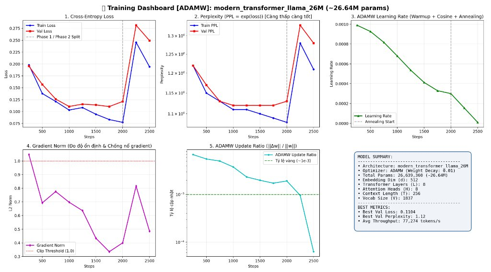
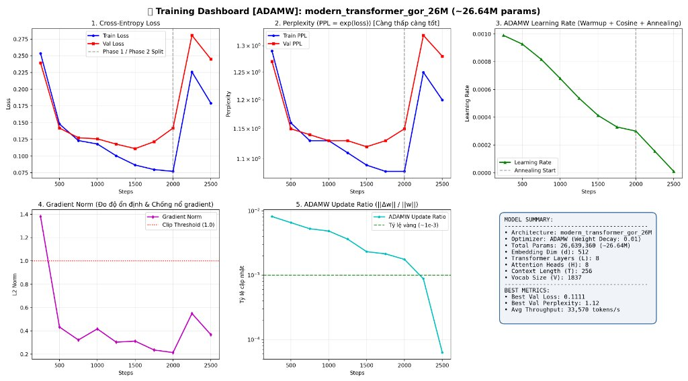
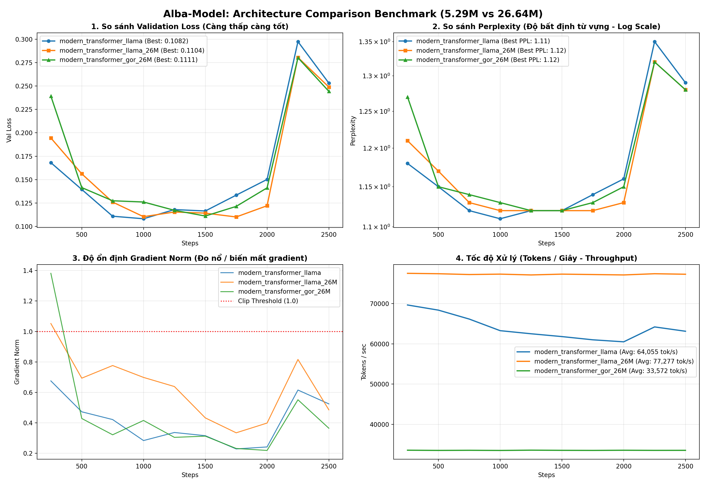

# 🌟 Alba-Model: Modern Decoder-Only LLM From Scratch

<p align="center">
  
  
  
  
  <a href="https://colab.research.google.com/github/khangkaka066/Alba-model/blob/main/main.ipynb">
    
  </a>
</p>

**Alba-Model** is a lightweight, high-performance **Decoder-Only Language Model** (~5.29M parameters) engineered entirely from scratch in PyTorch. It incorporates the latest architectural advances found in modern frontier LLMs (Meta LLaMA 3, Mistral, and DeepSeek), featuring a **Byte-Level BPE tokenizer**, a **Two-Stage Pre-training Curriculum (with an Annealing Phase)**, and an in-depth **Adam/AdamW optimizer diagnostics suite**.

---

## 📑 Table of Contents

- [🏆 Proven Improvements Visual Ledger (Improve.html)](Improve.html)
- [Architectural Highlights](#-architectural-highlights)
- [Two-Stage Pre-training Curriculum](#-two-stage-pre-training-curriculum)
- [Byte-Level BPE (BBPE) Tokenizer](#-byte-level-bpe-bbpe-tokenizer)
- [Optimizer Diagnostics & Metrics](#-optimizer-diagnostics--metrics)
- [Repository Structure](#-repository-structure)
- [Quickstart Guide](#-quickstart-guide)
  - [1-Click Google Colab](#1-run-on-google-colab-recommended)
  - [Local Setup & Training](#2-run-locally-mac-gpu-mps--cuda--cpu)
  - [Model Comparison Tool](#3-benchmarking--comparing-architectures)
- [Methodology & Specifications](#-methodology--specifications)

---

## 🏗️ Architectural Highlights

Alba-Model abandons legacy Transformer constructs (e.g., standard LayerNorm, absolute positional embeddings, and vanilla MLPs) in favor of the modern open-weights consensus:

```text
                  Input Tokens [x_1, x_2, ..., x_T]
                               │
                               ▼
               [Token Embeddings (d = 256)]
                               │
       ┌───────────────────────┴───────────────────────┐
       │                                               ▼
       │                                     RMSNorm(x)
       │                                               ▼
       │                             Query / Key / Value Projections
       │                                               ▼
       │                                Rotary Position Embedding (RoPE)
       │                                               ▼
       │                                Causal Multi-Head Self-Attention
       │                                               ▼
       │                                     Output Projection (W_o)
       │                                               ▼
       └──────────────────────────────►(+)◄────────────┘ (Residual Connection 1)
                                        │
                                        ▼
                                        h
                                        │
       ┌────────────────────────────────┴──────────────┐
       │                                               ▼
       │                                     RMSNorm(h)
       │                                               ▼
       │                          SwiGLU FFN: W_2(SiLU(W_1 x) ⊙ W_3 x)
       │                                               ▼
       └──────────────────────────────►(+)◄────────────┘ (Residual Connection 2)
                                        │
                                        ▼  (Repeated across 6 Layers)
                               Final RMSNorm
                                        │
                                        ▼
                         Output Head (Weight-Tied Projection)
                                        │
                                        ▼
                      Next-Token Logits [p(x_{t+1} | x_{<=t})]
```

### Key Technical Innovations:
1. **RMSNorm (Pre-normalization):** Eliminates the mean-computation step of LayerNorm, reducing compute overhead while stabilizing deep gradient propagation.
2. **RoPE (Rotary Position Embedding):** Encodes positional distance via complex 2D rotation angles on Query and Key vectors ($e^{i m \theta}$), delivering superior relative-position awareness.
3. **SwiGLU Activation:** Employs Gated Linear Units with the SiLU/Swish activation function, significantly boosting mathematical and algorithmic reasoning performance over ReLU/GELU.
4. **Causal Scaled Dot-Product Attention (SDPA):** Hardware-accelerated causal attention (FlashAttention / Apple MPS compatible) preventing information leakage from future tokens.
5. **Weight Tying:** Shares the embedding weight matrix with the final output projection head, saving ~1.05M redundant parameters.

### Model Architectural Variants & Hyperparameters:

| Variant | Parameters | Layers ($L$) | Hidden Dim ($d$) | Heads ($H$) | SwiGLU Dim | Residual Connection | Best Val Loss | Best Val PPL | Gradient Norm |
|---|---|---|---|---|---|---|---|---|---|
| **Alba-5M (Compact Baseline)** | `5,290,496` (~5.29M) | 6 | 256 | 4 | 688 | Standard ($x + u$) | **0.1082** | **1.11** | ~0.45 |
| **Alba-26M (Standard LLaMA)** | `26,639,360` (~26.64M) | 8 | 512 | 8 | 1,376 | Standard ($x + u$) | **0.1104** | **1.12** | ~0.65 - 0.80 |
| **Alba-26M (GOR-v2 Innovation)** | `26,639,360` (~26.64M) | 8 | 512 | 8 | 1,376 | **Geometric Orthogonal v2** | **0.1111** | **1.12** | **~0.25 - 0.35 (50% Flatter)** |

### 📊 Empirical Training Dashboards & Benchmark Comparison:

| Alba-26M Standard LLaMA | Alba-26M GOR-v2 Innovation |
|---|---|
|  |  |

#### Head-to-Head Architecture Comparison Benchmark (Standard vs GOR-v2):
<p align="center">
  
</p>

---

## 📚 Two-Stage Pre-training Curriculum

Following the curriculum learning strategies of **LLaMA 3**, **DeepSeek-V3**, and **MiniCPM**, training is split into two distinct, high-impact phases:

```text
[ STAGE 1: FOUNDATION (80% of steps) ]
  ├── 45% Educational Text & Stories (Science, biology, astronomy, narrative prose)
  ├── 35% General Python Code (Algorithms, data structures, control flow)
  ├── 10% Basic Mathematics (Arithmetic, operator precedence)
  └── 10% General Knowledge (World facts, natural sciences QA)
                         │
                         ▼
[ STAGE 2: ANNEALING PHASE (20% of steps) ]
  ├── 40% Deep Math & Logic (Linear equations mx + b = c, inequalities, ratios)
  ├── 40% Clean Code (PEP 484 type annotations, full docstrings, assertions)
  └── 20% Synthetic Chain-of-Thought (Scratchpad reasoning with <think>...</think>)
  └── Learning Rate Cooldown: Smooth decay from 3e-4 down to 1e-5
```

---

## 🔤 Byte-Level BPE (BBPE) Tokenizer

The custom tokenizer is built on **Byte-Level Byte-Pair Encoding** (standardized by GPT-4 and LLaMA):
- **Zero Out-of-Vocabulary (OOV):** Grounded in the 256 fundamental UTF-8 bytes ($0\text{x}00 \rightarrow 0\text{xFF}$). Any unseen character, symbol, or foreign language decomposes into raw bytes (Byte-fallback) with **zero `<unk>` tokens**.
- **Individual Digit Tokenization:** Every digit (`0` through `9`) is explicitly split (`Digits(individual_digits=True)`), enabling the model to learn multi-digit column arithmetic instead of treating large numbers as opaque symbols.
- **Whitespace & Code Preservation:** Spaces and indentation are preserved via byte tokens (`Ġ`), retaining precise Python indentation structures.
- **Dedicated Reasoning Tokens:** Embedded `<think>` and `</think>` tags to structure Chain-of-Thought scratchpads.

---

## 🔬 Optimizer Diagnostics & Metrics

When comparing different architectures, measuring Loss alone is insufficient. Alba-Model tracks **5 scientific metrics** saved to `checkpoints/metrics.json` and visualizes them on a 6-panel dashboard:

1. **Cross-Entropy Loss:** Evaluated on independent Train and Validation splits.
2. **Perplexity ($\text{PPL} = \exp(\mathcal{L})$):** Measures model uncertainty; lower PPL indicates sharper predictions.
3. **Adam Update-to-Weight Ratio ($\frac{\|\Delta \theta\|_2}{\|\theta\|_2}$):** The gold-standard optimizer diagnostic. Tracks whether step updates stay in the sweet spot ($\sim 10^{-3}$) or risk divergence ($> 0.1$).
4. **Gradient Norm ($\|\nabla_\theta \mathcal{L}\|_2$):** Monitors training stability and guards against gradient explosions or vanishing gradients.
5. **Throughput & Latency:** Real-time tokens/second and step latency (ms) for benchmarking computational efficiency.

---

## 📁 Repository Structure

```text
Alba-model/
├── main.ipynb                   # Master Google Colab Dashboard (1-click execution)
├── README.md                    # Project overview & quickstart guide
├── TRAINING_METHODOLOGY.md      # Scientific specification for curriculum & metrics
├── train.py                     # Multi-phase training engine (AdamW/Adam, metrics tracking)
├── generate.py                  # Autoregressive generation & CoT problem solver
├── compare_models.py            # CLI tool for multi-architecture comparative analysis
├── typing_extensions.py         # Environment compatibility shim
├── checkpoints/
│   ├── best_model.pt            # Serialized weights of the best checkpoint
│   └── metrics.json             # Full training history & evaluation logs
├── data/
│   ├── prepare_data.py          # Synthetic curriculum data generator
│   ├── process_data.py          # High-speed uint16 binary tensor compiler
│   ├── raw/
│   │   ├── phase1_foundation.txt
│   │   └── phase2_annealing.txt
│   └── processed/
│       ├── phase1_train.bin & phase1_val.bin
│       └── phase2_train.bin & phase2_val.bin
├── tokenizer/
│   ├── train_tokenizer.py       # Byte-Level BPE training script
│   └── tokenizer.json           # Serialized vocabulary (1,837 tokens)
└── src/
    ├── __init__.py
    ├── config.py                # Model hyperparameter dataclass (ModelArgs)
    ├── model.py                 # PyTorch Transformer (RMSNorm, RoPE, Attention, SwiGLU)
    └── dataset.py               # Memory-mapped (np.memmap) zero-copy DataLoader
```

---

## 🚀 Quickstart Guide

### 1. Run on Google Colab (Recommended)
You can train and evaluate Alba-Model on a free Google Colab **Nvidia T4 GPU**:

[](https://colab.research.google.com/github/khangkaka066/Alba-model/blob/main/main.ipynb)

1. Open [`main.ipynb`](https://colab.research.google.com/github/khangkaka066/Alba-model/blob/main/main.ipynb) via the badge above.
2. Navigate to **Runtime** $\rightarrow$ **Change runtime type** $\rightarrow$ select **T4 GPU**.
3. Click **Runtime** $\rightarrow$ **Run all**.

---

### 2. Run Locally (Mac GPU MPS / CUDA / CPU)

Clone the repository and install requirements:

```bash
git clone https://github.com/khangkaka066/Alba-model.git
cd Alba-model
pip install torch tokenizers matplotlib
```

#### Step A: Generate Curriculum Data
```bash
python data/prepare_data.py
```

#### Step B: Train the Tokenizer
```bash
python tokenizer/train_tokenizer.py
```

#### Step C: Compile Binary Datasets
```bash
python data/process_data.py
```

#### Step D: Pre-train the Model
```bash
# Trains with AdamW across Phase 1 (80%) and Phase 2 (20% Annealing)
python train.py --exp_name alba_v1 --max_iters 2500 --batch_size 32 --seq_len 128 --lr 1e-3
```

#### Step E: Test Inference & Math Reasoning
```bash
# Multi-step arithmetic reasoning with Chain-of-Thought
python generate.py --prompt "Instruction: Solve the multi-step word problem with detailed logical chain of thought.\nQuestion: Alice has 35 apples. Alice gives 12 to Bob and buys 8 more. How many apples does Alice have now?\n<think>" --temperature 0.3

# Clean Python code generation
python generate.py --prompt "# Python Implementation: binary_search\ndef binary_search(arr: list[int], target: int) -> int:" --temperature 0.2
```

---

### 3. Benchmarking & Comparing Architectures

When experimenting with alternative architectural variants (e.g., LayerNorm vs. RMSNorm, GELU vs. SwiGLU, or Adam vs. AdamW):

```bash
# 1. Train Model A (AdamW)
python train.py --exp_name arch_adamw --optimizer adamw --max_iters 2000

# 2. Train Model B (Standard Adam)
python train.py --exp_name arch_adam --optimizer adam --max_iters 2000

# 3. Compare their learning curves, Perplexity, and gradient stability
python compare_models.py --files checkpoints/arch_adamw_metrics.json checkpoints/arch_adam_metrics.json --output comparison.png
```

---

## 📖 Methodology & Specifications

For an in-depth mathematical breakdown of the two-stage curriculum, token distribution tables, and optimizer diagnostic thresholds, consult [`TRAINING_METHODOLOGY.md`](TRAINING_METHODOLOGY.md).
